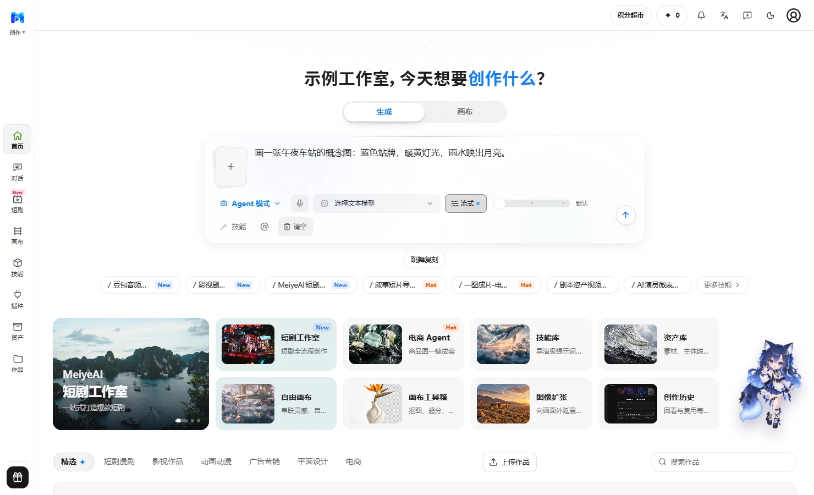
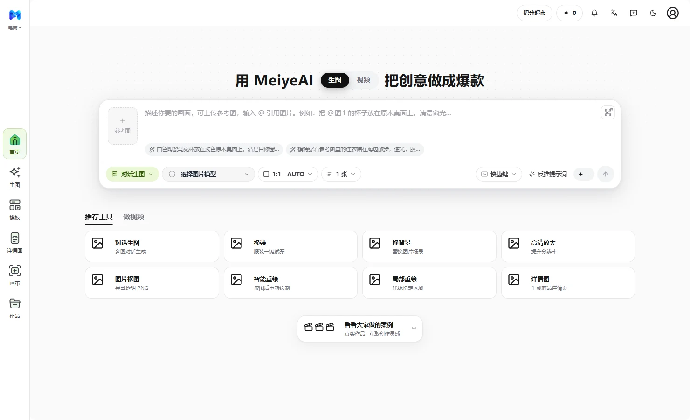
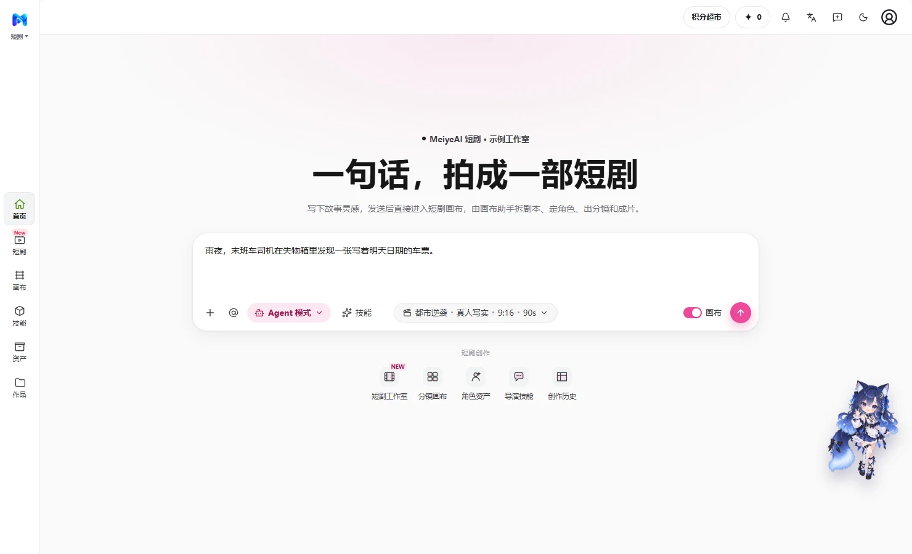
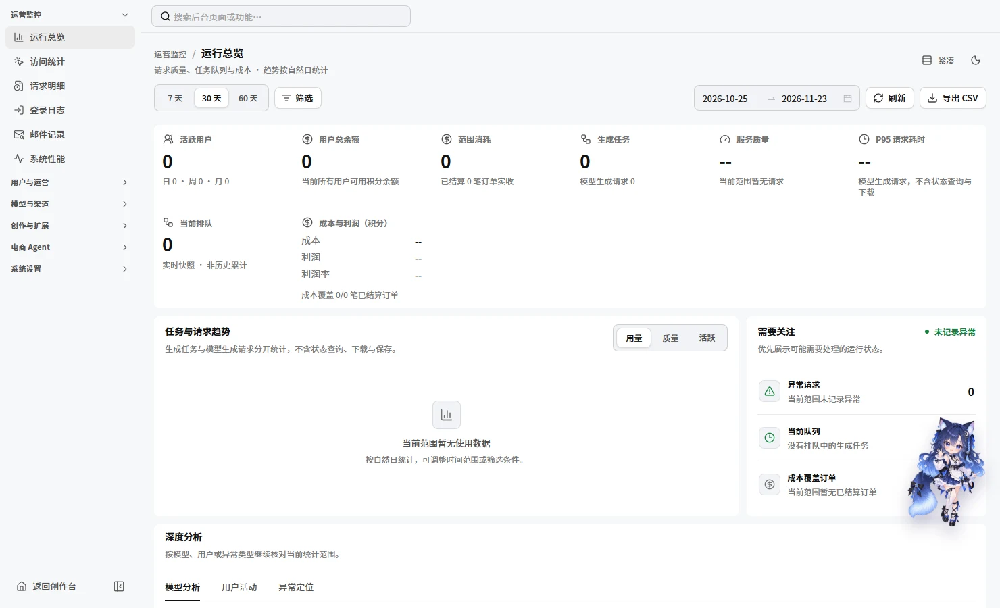

<h1 align="center">Ww · 影策工作台</h1>
<p align="center"><strong>写下一个故事，拍成一部短剧；拍下一件商品，做出一组商品图。</strong></p>
<p align="center"><a href="#产品一览">产品一览</a> · <a href="#本地启动">本地启动</a> · <a href="docs/index.md">开发文档</a> · <a href="SECURITY.md">安全策略</a></p>

影策把创作、短剧和电商放在同一个工作台。写短剧时，可以按集整理原文，把台词、动作和运镜拆成分镜；做商品图时，从一张参考图开始换背景、试穿或编排详情页。需要比较几个方向时，就在自由画布上把文字和画面放在一起。


<p align="center"><em>《末班车的来信》 · 本地示例项目，三章原文，首集六个手写分镜，尚未生成视频。</em></p>

## 产品一览

| 创作工作台 | 电商工作台 |
| --- | --- |
|  |  |
| 从一句提示词开始生成图片或视频，也可以带着素材进入自由画布。跳舞复刻使用一张角色图和一段参考舞蹈视频。 | 上传商品参考图，选择换装、换背景、局部重绘或详情图；图片、普通视频和历史作品都可以在电商工作台管理。 |

| 短剧创作 | 运行后台 |
| --- | --- |
|  |  |
| 写下故事开头，选定画幅和风格。进入制作台后，逐集核对角色、台词和镜头，在生成前调整节奏。 | 管理员在这里配置模型渠道、用户、积分、支付与存储，查看任务排队和请求记录。图中是本地示例环境。 |

## 本地启动

安装 Git、Docker 和 Docker Compose；在有仓库读取权限的终端执行：

```sh
git clone https://github.com/WMRBYY/Ww-E-commerce-short-drama-Agent.git
cd Ww-E-commerce-short-drama-Agent
docker compose up -d --build
```

浏览器打开 [localhost:3000](http://localhost:3000)，在本机完成首个管理员注册。在后台开启需要的工作模式，再添加自己的模型渠道并选择模型。跳舞复刻要选支持图片和视频参考的模型；要启用收款或对象存储，请另行配置自己的商户和存储服务。只浏览界面不需要提交生成任务。

想直接修改源码？参见[本地开发指南](docs/LOCAL_SETUP.md)。构建、页面检查和第三方接入的验证情况记录在[验证记录](docs/VALIDATION.md)。

## 代码从哪里读

| 目录 | 入口 |
| --- | --- |
| [web](web/README.md) | 三种工作模式、画布与管理界面 |
| [backend](backend/README.md) | 账号、项目、任务与数据存储 |
| [yingce-agent](yingce-agent/README.md) | 独立的 Agent 会话运行时 |
| [plugin-packages](plugin-packages/README.md) | 模型协议、支付插件与打包方式 |
| [docker](docker/README.md) · [scripts](scripts/README.md) · [tools](tools/README.md) | 容器、开发校验与维护工具 |

代码采用 [MIT 许可证](LICENSE)。上游署名与第三方资源说明见 [NOTICE](NOTICE)。
